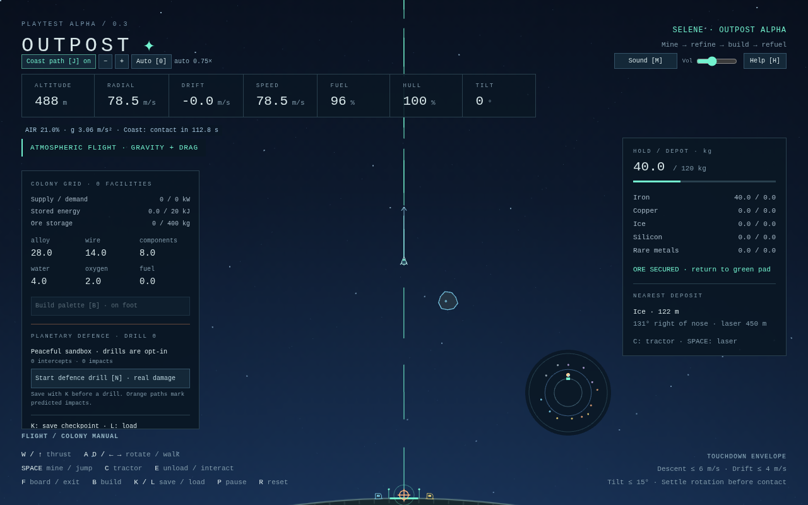
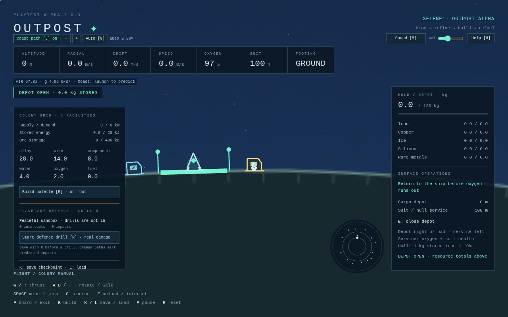
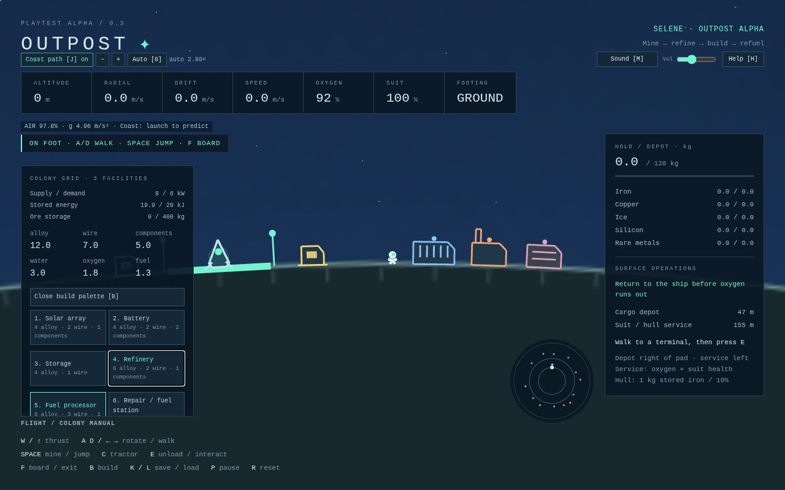
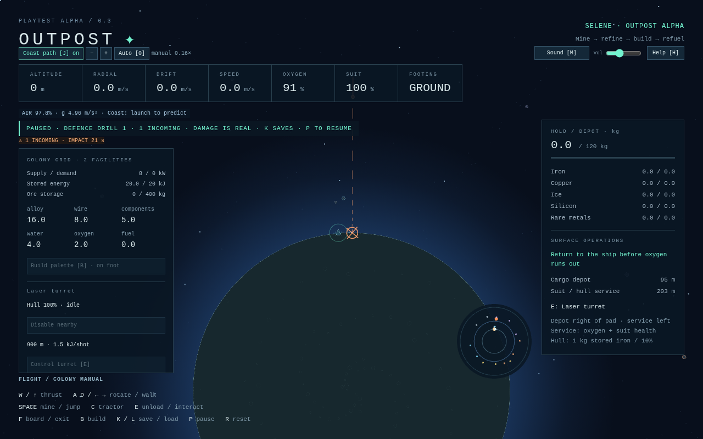

# Outpost

A single-player, retro-inspired 2D spaceflight, asteroid mining, combat and colony-building game. Target balance: **60% action / 40% construction**.

**Status:** Playtest alpha 0.3. Phases 0–4, sound/help and atmospheric flight are merged through PR #7. This iteration implements Phase 5 planetary defence for review: opt-in physical meteor drills, three powered turret variants, automatic targeting and persistent building damage/repair. Enemy spacecraft and later progression/logistics remain deferred.

## Play locally

Requires Node.js 22.12+ (or 24+) and npm. No backend, API keys, external art or services are required.

```sh
npm install
npm run dev
```

Open the local Vite URL in a modern desktop browser. Click the game if keyboard focus is elsewhere. The canvas resizes with the window.

| Key | Action |
|---|---|
| W / Up | Main engine in ship; jump on foot |
| A / Left, D / Right | Rotate in ship; walk left / right on foot |
| Space | Mine in ship; jump on foot; fire controlled turret |
| C | Tractor nearby ore (hold) |
| E | Unload while piloting a landed ship; interact with nearby surface terminal on foot |
| F | Leave landed ship / board within 20 m |
| B / 1–9 | Toggle build palette / choose facility (on foot) |
| Q / T / Enter | Shift preview left/right 32 m / place |
| X / V | Demolish nearby facility (palette open) / cycle nearby refinery recipe |
| N | Start opt-in defence drill (real damage) |
| G / U | Toggle nearby turret automation / repair nearby building |
| K / L | Save / load browser checkpoint |
| H / M | Quick-start guide / sound mute |
| J | Toggle current coast trajectory |
| Wheel / − / + | Manual camera zoom (also while paused) |
| 0 | Restore automatic zoom |
| P | Pause / resume |
| R | Reset runtime sandbox, including colony; keep saved checkpoint |

The game also pauses when its window loses focus or the tab is hidden. Press P to resume; keys are released on pause to avoid queued actions. Flight controls rotate the ship in world space even as the camera reorients.

The **H** guide includes a first-sortie and construction walkthrough, pauses safely, and returns to your previous pause state when closed. **M** mutes; the top bar controls volume. Sound starts only after your first click/key, and uses original procedural engine/mining/tractor/machinery loops plus landing, impact, pickup, airlock, footstep, construction and warning cues. All audio silences on pause/focus loss. Sound preferences persist separately from your world checkpoint; no external sound assets or music are used. See [the playtest route](docs/PLAYTEST.md).

For a first return flight, launch vertically for about **6.5 seconds**, holding Space to clear the starter deposit above the pad (or steering around it), then coast. Keep the nose upright. Watch radial velocity: positive means climbing, negative means descending. Use short thrust pulses on descent, starting early to keep descent under 30 m/s, then reduce it below 6 m/s near the pad. Thrust is an acceleration; releasing W leaves gravity and atmospheric drag acting on your momentum. With a clear flight path, this low hop peaks around 467 m; a roughly 10-second vertical burn reaches about 1.7 km. Sustained burns can escape the moon; turn around and burn to return, or press R to practice again.

For orbital flight, gradually pitch toward the horizon after launch and build tangential speed. Circular speed is about 69 m/s at 1,600 m altitude, above the 1,200 m atmosphere. Low atmospheric orbits lose energy to drag. The dashed **J coast path** predicts up to 180 seconds with controls released, using the same gravity, drag and terrain collision as live flight. It stops at first terrain contact; rocks, powered tools and future control inputs are excluded. The arrow shows current velocity. **Wheel / − / +** sets manual zoom; **0** returns to altitude-based auto zoom.

The small radar shows the moon, green home pad and amber ship, including when home is off screen. Land on the green pad with radial speed ≤ 6 m/s, tangential speed ≤ 4 m/s, tilt ≤ 15° and angular speed ≤ 0.35 rad/s. A safe touchdown locks the ship to the pad until thrust resumes. Moderate impacts damage hull and rebound; hard or overturned impacts crash. Landing does not refill fuel or repair hull.

## First mining sortie

A starter iron sample is directly above the home pad. Hold **W + Space + C** to launch, mine and attract ore. Release **W after about 6.5 seconds**, keeping Space/C held while coasting toward the deposit. The beam breaks a parent rock into two fragments; mine those again for ore. The powered tractor pulls ore within 260 m and collects it within 18 m. Use the same vertical descent practice described above, then press **E** on the pad to transfer the hold into the depot. The simulation regression performs this entire sortie with ordinary control inputs. Avoid holding thrust until the hold fills: the ship can reach escape speed before collection finishes.

For other deposits, steer by the nearest-deposit bearing and colored radar blips. A radial ice sample also starts just right of the iron sample above home. Keep the nose on the rock within laser range (450 m); nearer rocks and the moon block the beam. Parents split into two mineable fragments; each fragment releases four drifting ore pickups. Resource mass and fracture momentum are conserved. The 120 kg hold accepts partial stacks and leaves the remainder in space. Cargo adds to ship mass. All five resources have separate hold/depot totals. Rock impacts damage hull. Pause freezes the entire world. R resets all runtime progress; K/L protects a saved checkpoint.



## Explore the surface

Press **F** on the home pad to leave the ship. Use **A/D** or the arrows to walk around the curved moon. Press **Space** (or W/Up) to jump; release before jumping again. Ground motion accelerates and brakes, while airborne motion retains momentum under radial gravity. The camera smoothly moves to the astronaut and zooms closer. Ship engines and tools are disabled while the pilot is outside; asteroids and ore keep moving.

The amber **cargo depot** is about 54 m right of the pad. Grounded E opens inventory and transfers the landed ship's hold, leaving overflow aboard if storage is full. E again closes, or walk away. The blue **home emergency service** is about 54 m left: E restores suit oxygen/health, repairs the landed ship using stored iron (**1 kg / 10 hull points**), and transfers any manufactured fuel available. Its emergency suit service remains free. Buildable service stations use grid energy and manufactured supplies.

The suit has **180 seconds of oxygen**. Return to the ship (F within 20 m) or use the service point before it runs out. At zero oxygen, health drains at 5 points/second. Falls above 14 m/s also cause damage; ordinary jumps are safe. A lost suit requires R to restart the entire sortie. Boarding refills oxygen; suit health stays damaged until serviced. You can walk through ship/station art; terrain is the suit's collision surface in this milestone.



## Build a colony and refuel

The finite starter kit contains **28 alloy, 14 wire, 8 components, 4 water and 2 oxygen**. Raw ore still comes from mining; the kit never replenishes unless the runtime is reset. Blueprint buttons show exact material costs.

1. Leave the ship with F. Walk right past the depot to about 100 m from the pad. Press B: the preview follows the rim 24 m ahead. Green means a valid affordable site; red explains a blocked site. Keep the pad, home terminals and other facilities clear.
2. Enter builds the selected **solar array**. T shifts the preview 32 m right; choose **4** and Enter for a **refinery**. T again, **5**, Enter builds a **fuel processor**. Mouse palette/placement buttons provide the same actions. Build within 96 m of the crew; walk farther to extend the colony.
3. The array supplies 8 kW; the fuel processor uses 6 kW and converts starter water/oxygen into fuel. The refinery waits for ore. Every recipe needs power, inputs and output room. Production continues while you are flying.
4. Mine ice, return and unload. Walk within 18 m of the refinery and press **V** to select **Ice → water + O₂** (after iron, copper and components). E toggles machines. Iron makes alloy, copper makes wire, and 0.9 silicon + 0.1 rare metals makes one component. Recipe choice changes discard incomplete cycle progress.
5. Fuel processors turn **1 water + 0.25 oxygen into 1.25 fuel** in 3 powered seconds. Return to the landed ship and E unloads/refuels from colony tanks, up to tank capacity. Fuel never appears without feedstock. Built repair/fuel stations also transfer fuel within 80 m of a landed ship, use 2 kJ per service, and spend alloy on hull repair and oxygen on suit refill.
6. Add **batteries** for 200 kJ each (base capacitor 20 kJ), **storage** for 200 kg extra ore and 100 kg extra room per manufactured product (base 400 kg ore / 100 kg each product), and **repair/fuel stations** for away-from-home suit service. X removes a nearby facility while B is open, refunding up to 75% scaled by remaining hull; removing essential storage is blocked, and excess battery charge is discarded.

The left colony ledger shows generation/demand, energy, material stocks and machine status. Scroll the panel to reach all controls. The grid and inventories form a single global bus in this prototype; solar output is constant. Production machines receive power in placement order, followed by turrets in placement order. If total demand exceeds generation, batteries buffer the deficit and machines wait rather than generating free output. Storage and batteries are passive capacities with no power switch. Facilities remain non-solid surface markers, but meteor impacts damage them and wrecks stop operating.



## Defend the colony

Build solar and **7 laser / 8 flak / 9 missile turrets** using the palette. Walk within 18 m and **E** to control one; **A/D** aims, **Space** fires, and **E** releases. **G** toggles nearby automatic defence; release manual control for unattended targeting. All shots consume grid energy; flak/missiles also spend alloy/components. No shot refunds or free ammunition are provided.

**K saves before a drill. N starts an incoming meteor drill with real damage.** Drills never start automatically. Orange radar dots, paths and impact markers give early warning; zoom out to follow them. A parent meteor splits into dangerous fragments, so keep firing until the incoming count is zero. The ship mining laser can intercept too. Impacts damage buildings, ship and exposed crew; **U** repairs nearby buildings with alloy (1 kg per 10 hull). Wrecks stop operating; destroyed storage can lose overflow inventory. See [defence controls, costs and limits](docs/DEFENCE.md).



## Save and resume

**K** writes one local browser checkpoint. **L** restores it, and page startup automatically loads an existing checkpoint **paused**; press P to resume. Saves include the entire world: facility placement, production timers, energy, raw/manufactured inventories, depleted asteroid field, ship and suit. Thus loading does not recreate already-mined ore. R starts a fresh runtime sandbox while keeping the last checkpoint; L recovers it. Saving the new runtime with K deliberately replaces that checkpoint.

Saves are local to the browser/origin and are not cloud synced. There is no autosave or offline production. Version-1 checkpoints migrate to the larger planet, preserving altitude, local heading, signed surface distance from home, inventories, facilities and depleted deposits. They load paused; old orbital paths change with the environment. Version-2 worlds gain peaceful defence state without changing planetary coordinates. K writes version 3 using the existing storage slot, including active threats/projectiles, turret settings, building damage and spent resources. Loading releases manual turret control. Unsupported future formats are rejected. Invalid checkpoints and storage failures leave the live world playable, with feedback. The versioned bounded loader rejects malformed data; a mature save/backup/migration system remains a later roadmap phase.

## Verification

```sh
npm run build
npm run typecheck
npm run test
npx playwright install chromium
npm run test:browser
npm run test:preview
```

`npm run preview` serves the production build. `dist/` can be hosted on any static HTTP server. `test:browser` checks the dev server; `test:preview` checks the built game. CI runs typecheck, unit tests, build and production Chromium checks, and uploads screenshots, results and the `outpost-playtest` static build artifact.

The **120 unit tests** cover flight, mining, suit/camera behavior, colony construction/power/storage/recipes/refuelling/checkpoints and audio event selection/preferences. Scenarios cover mining return/delivery, depot walking/relaunch, and unloaded ice → water/oxygen → fuel → ship refuel with recipe mass conservation. **Ten production Chromium checks** cover flight, surface controls, mining, construction/production/checkpoint restoration, corrupt saves, actual Web Audio output/silence/preferences, and help/pause/modified shortcut behavior. Screenshots include the [quick-start guide](docs/screenshots/playtest-guide.png). Additional checks cover full defence victories for all weapon variants, impact/repair and scarcity, manual/automatic turret controls, active-drill checkpoint continuation, gravity/drag, orbital energy, collision/tractor momentum, trajectory accuracy, zoom and legacy saves. See the [atmosphere and trajectory](docs/screenshots/atmosphere-trajectory.png). Full mining return is also verified in simulation; other browsers, human feel and subjective sound balance remain for the playtest.

## Architecture and tuning

- `src/sim/`: pure TypeScript state, Cartesian meters and seconds, 60 Hz accumulator; no Phaser/DOM imports. `world.ts` owns pilot mode, suit, ship, field, depot and button-edge state. `astronaut.ts` contains suit movement/safety (`SUIT` tuning); `surface.ts` owns boarding and stations; `cargo.ts` shares inventory transfer without simulation module cycles. Flight, bodies, mining and typed resources remain separate. Total ship mass is dry hull plus fuel plus cargo.
- `src/sim/colonyConfig.ts`, `colony.ts`, `colonyService.ts`: blueprints/recipes, placement/production/power and supplied service/refuelling. `stations.ts` and `messages.ts` share home geometry/feedback without runtime module cycles.
- `src/persistence/`: versioned full-world snapshot encoding, bounded validation and storage adapters; browser storage is accessed only by the scene.
- `src/audio/`: pure state-to-cue director, guarded preferences and a procedural Web Audio mixer. Phaser's unused sound manager is disabled; audio never mutates simulation state.
- `src/input/`: keyboard sampling per physics step, retaining short F/E/Space presses until consumed, and focus/pause-safe release.
- `src/render/`: Phaser scene, procedural world/ship/stars/radar and a smoothed follow frame. Local-up rotation blends into the inertial frame between 900 and 1,800 m altitude; zoom follows altitude continuously unless manually overridden. A transformed world container renders the camera frame, keeping HUD/radar in screen coordinates.
- `src/ui/`: DOM telemetry and controls, outside world transforms.
- `tests/`: simulation/camera regressions and real Chromium smoke test.

Collision uses a circular 7 m hull swept against the 1,800 m planet, then classifies pad contact by arc tolerance, speed, tilt and spin. Shared environmental integration applies inverse-square radial gravity, fuel-limited thrust and mass-dependent quadratic atmospheric drag. Gravity smoothly becomes linear inside the planet and reaches zero at its center. Drag reaches zero at 1,200 m; vacuum has no artificial linear damping. See [the physics model](docs/PHYSICS.md) for tuning and limitations. Phaser delta smoothing is disabled so the accumulator receives elapsed time even at low rendering rates. Catch-up is capped at 15 steps/250 ms; long stalls intentionally discard time. Angular damping stabilizes steering without changing linear inertia.

Known limitations: a fixed non-rotating planet, no mutual object gravity, lift, wind or heating; simplified isotropic drag and collision radii; coast prediction excludes traffic/tools; smooth circular terrain; approximate ship/suit collision; suit collides with terrain only, with no air steering, EVA or backpack; buildings are non-solid, with meteor blast damage and supplied repair. No flight autopilot, interpolation, wiring, day/night, offline production or advanced logistics. The finite 15-deposit field does not respawn. Fragments interact with rocks/ship/surface; ore interacts with gravity/surface/tractor and passes through rocks. Ship/rock contacts are swept; rock/rock contacts use discrete separation. Panels target desktop widths and are hidden below 560 px; mobile controls are out of scope. Phaser's roughly 1.29 MB minified JS bundle (~360 KB gzip) emits Vite's standard large-chunk warning.

Next: review and human playtesting of the defence slice before Phase 6 ship combat. See [the pre-playtest review](docs/PLAYTEST_REVIEW.md). Further roadmap systems remain separate milestones.

## Start here
- [Master development roadmap](docs/DEVELOPMENT_ROADMAP.md) — authoritative phases, task checkboxes, dependencies, exit criteria and progress.
- [Design decisions](docs/DECISIONS.md) — confirmed choices versus unresolved questions.
- [Game design](docs/GAME_DESIGN.md) — gameplay vision, mechanics and core loop.
- [Codex Task 001](CODEX_TASK.md) — first playable planetary flight prototype specification.
- [Codex Task 002](CODEX_TASK_002.md) — mining/cargo iteration scope and acceptance criteria.
- [Codex Task 003](CODEX_TASK_003.md) — astronaut and surface interaction scope.
- [Codex Task 005](CODEX_TASK_005.md) — planetary defence and building damage scope.
- [Codex Task 004](CODEX_TASK_004.md) — colony construction, economy and checkpoint scope.
- [Agent instructions](AGENTS.md) — technical architecture, coding and testing conventions.

## Core experience
Launch from a small circular moon, fly in a continuous 2D world with radial gravity and inertia, mine asteroids, fight threats, land, walk around, build/refuel a colony and defend it from incoming meteors. No separate flight/surface minigames.

## Development workflow
Implement one roadmap phase at a time on a feature branch. Open a PR with tests and playtest notes; update the roadmap and decision log. Do not merge automatically.

Tasks 001–004 and the sound/help pass were reviewed and merged in dependency order for this playtest at the user's explicit request. PR #7 was subsequently merged at the user’s explicit request. Further milestone PRs remain review-only unless separately authorized. See [the playtest route](docs/PLAYTEST.md) and [review notes](docs/PLAYTEST_REVIEW.md).
