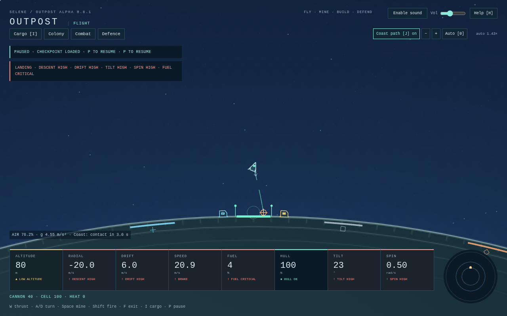
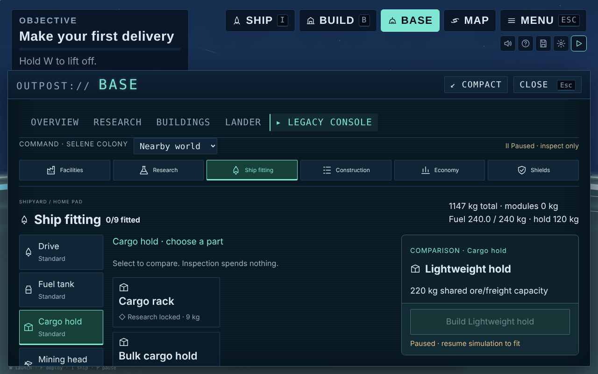
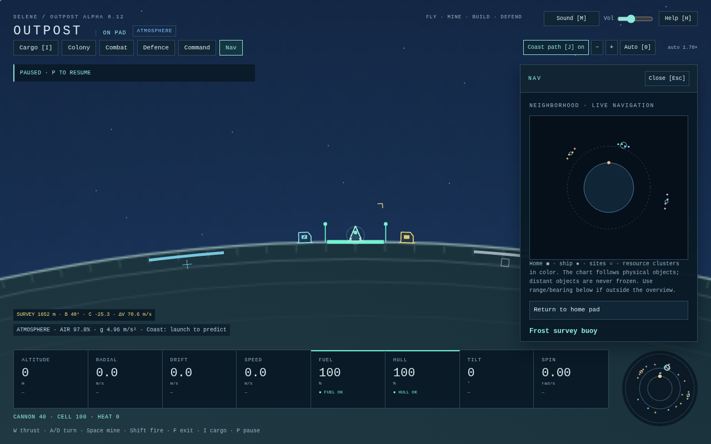
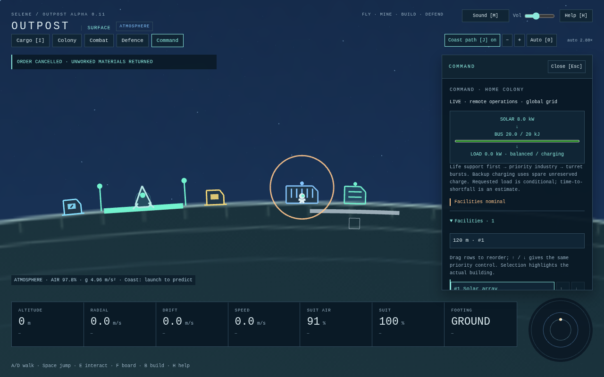
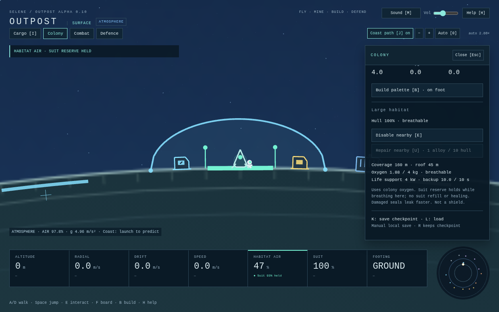
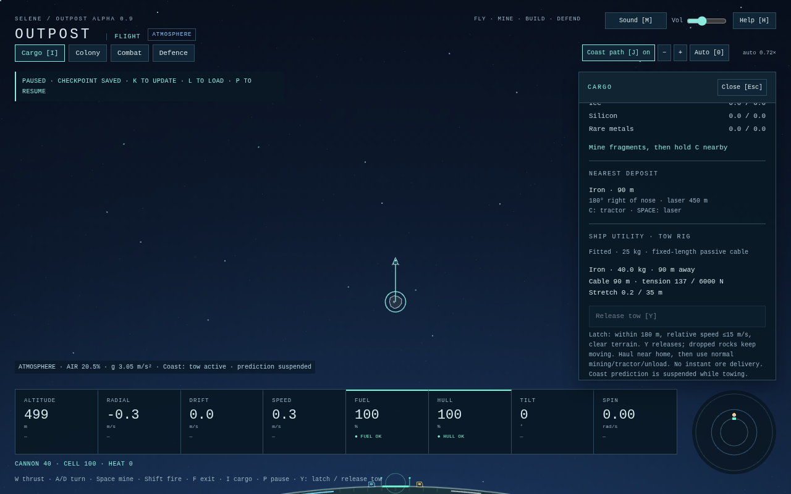
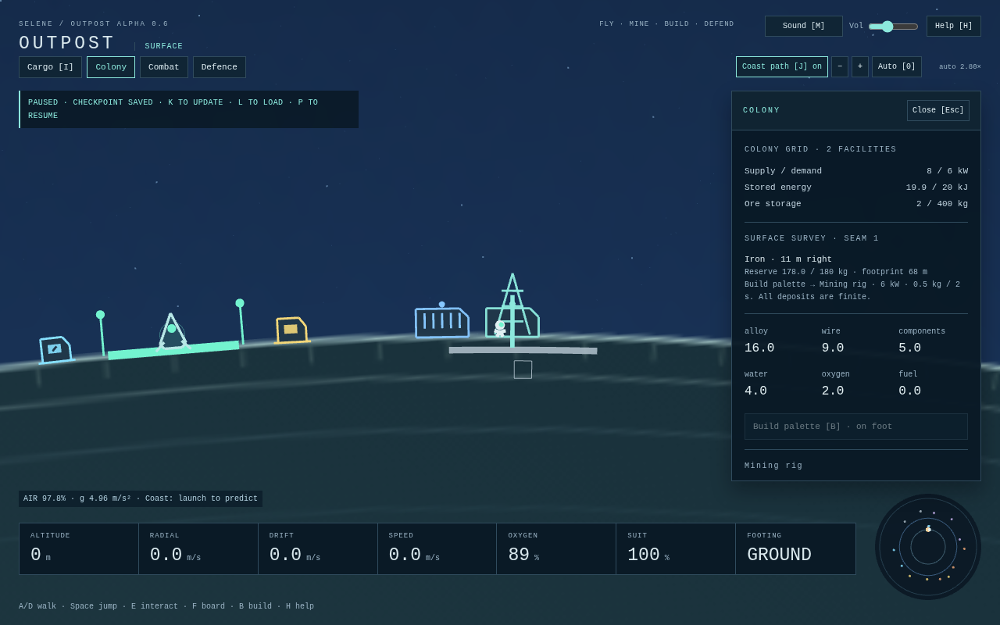
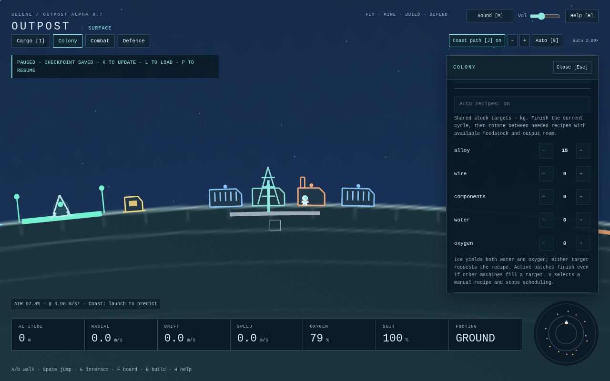
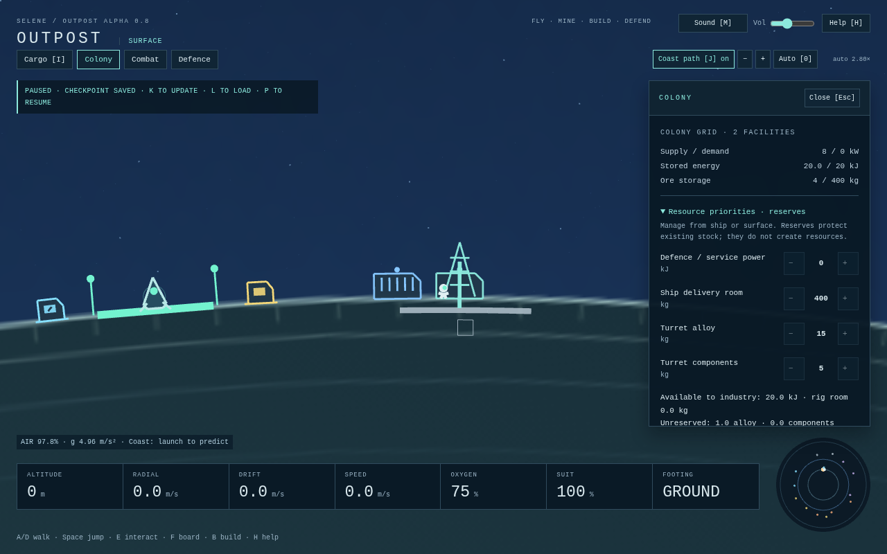
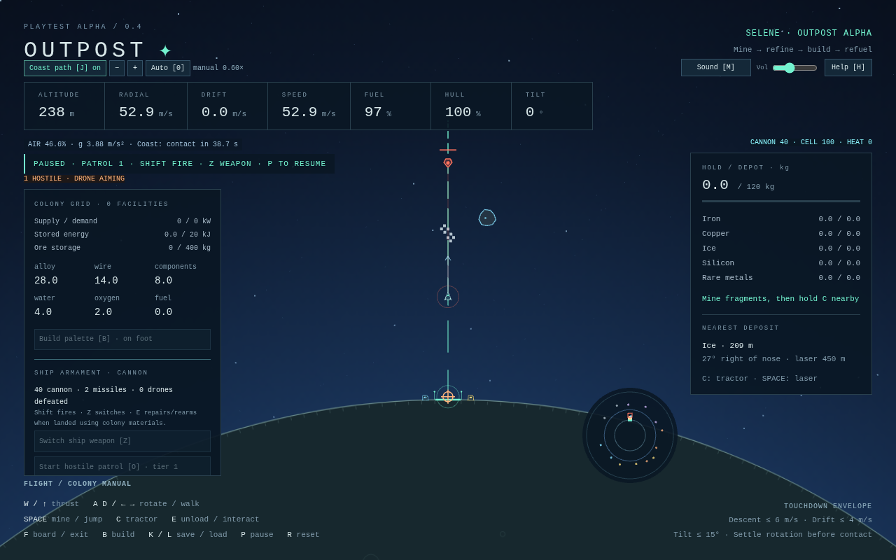

# Outpost

A single-player, retro-inspired 2D spaceflight, asteroid mining, combat and colony-building game. Target balance: **60% action / 40% construction**.

**Status:** Alpha 0.21 adds earned flight computers and focused facility administration on the alpha 0.20 management workspace. Nineteen paid technologies unlock twenty-five ship parts across nine exclusive slots and two facility upgrade tiers. Automatic landing, return-home and selected-destination flight use normal physics, propellant and cell power. Optional physical building labels open direct controls. See [automation, upgrades and playtest](docs/AUTOMATION_FACILITIES.md), [management workspace](docs/MANAGEMENT_WORKSPACE.md) and [compact instruments](docs/INSTRUMENT_CONSOLE.md). Human handling, pacing, hardware and release acceptance remain open.

## Play locally

Requires Node.js 22.12+ (or 24+) and npm. No backend, API keys, external art or services are required.

```sh
npm install
npm run dev
```

Open the local Vite URL in a modern desktop browser. New games show only the first-mining-sortie systems ([current focus](docs/CURRENT_FOCUS.md)); add `?features=all` to the URL to see every system, including the ones documented below. Choose **New Game**, or **Continue** for a valid current save (loads paused; P resumes). **Menu** offers Resume, Save/Load, Settings, Controls and Return to title. Click the game if keyboard focus is elsewhere. The canvas resizes with the window.

| Key | Action |
|---|---|
| W / Up | Main engine in ship; jump on foot |
| A / Left, D / Right | Rotate in ship; walk left / right on foot |
| Space | Mine in ship; jump on foot; fire controlled turret |
| C | Tractor nearby ore (hold) |
| Y | Latch / release an asteroid with the fabricated tow rig |
| E | Unload while piloting a landed ship; interact with nearby surface terminal on foot |
| F | Leave landed ship / board within 20 m |
| B / 1–9 | Toggle build palette / choose facility (on foot); select mining rigs/habitats using palette buttons |
| Q / T / Enter | Shift preview left/right 32 m / place |
| X / V | Demolish nearby facility (palette open) / cycle nearby refinery recipe |
| N | Start opt-in defence drill (real damage) |
| G / U | Toggle nearby turret automation / repair nearby building |
| Shift / Z | Fire ship combat weapon / switch cannon or missile |
| O / Backspace | Start opt-in hostile patrol above 200 m / recover a wreck using supplies |
| I / Esc | Toggle Cargo / close operations panel (Esc closes help first) |
| K / L | Save / load browser checkpoint |
| H / M | Quick-start guide / sound mute |
| J | Toggle current coast trajectory |
| Wheel / − / + | Manual camera zoom (also while paused) |
| 0 | Restore automatic zoom |
| P | Pause / resume |
| R | Reset runtime sandbox, including colony; keep saved checkpoint |

Top-right **Ship / Build / Base / Map / Menu** buttons open their panel; small icons below them toggle sound, open help and settings, and pause. The objective card (top-left) shows your current goal; status messages appear under it. Coast-path and zoom controls sit above the radar. **I** toggles Ship; **Esc** closes a panel, or opens the pause menu when none is open. **Base and Map pause the game while you are flying** and stay live on the pad or on foot. The bottom cluster shows fuel, hull and cargo, an attitude dial (nose and direction of motion against local up) and altitude, vertical speed and drift; touchdown limits appear on a landing approach. Master, effects and music volume are in Settings. See [current focus](docs/CURRENT_FOCUS.md) for the UI rebuild.

The game also pauses when its window loses focus or the tab is hidden. Press P to resume; keys are released on pause to avoid queued actions. Flight controls rotate the ship in world space even as the camera reorients.

The **H** guide includes a first-sortie and construction walkthrough, pauses safely, and returns to your previous pause state when closed. **M** mutes; the top bar controls volume. Sound starts only after your first click/key, and uses original procedural engine/mining/tractor/machinery loops plus landing, impact, pickup, airlock, footstep, construction and warning cues. All audio silences on pause/focus loss. Sound preferences persist separately from your world checkpoint; all audio is original and procedural. Settings provides separate music/effects levels, text sizing, reduced motion, graphics quality, camera rotation and key rebinding. The table above shows defaults; Settings and contextual hints show your current bindings. See [the playtest route](docs/PLAYTEST.md).

Cargo → Manufactured freight offers finite rig/solar and habitat/solar manifests. Objectives records real sandbox progress without granting resources. Click a built facility to select it in Command; paused actions remain inspection-only. See [the full presentation model](docs/PRESENTATION.md).

**Building:** press **Build** (or B) while landed or on foot. Pick a card in the build bar (keys 1–5), point at the ground and click: the ghost turns red with the reason if the spot will not work. Materials are set aside at once and the order appears in the queue, where × cancels it and refunds what has not been used. On foot your astronaut walks over and builds it; from the lander, step out (F) and they go automatically. Right-click, B or Esc stops building. Q / T and Enter place next to the astronaut without the mouse; X demolishes a nearby building. Outside build mode, right-click the ground to walk. See [the complete direct-control rules](docs/DIRECT_CONTROLS.md).

**Map:** shows Selene, the ore clusters (coloured by what they hold), salvage sites, the pad and you. Click a place on the chart or in the list to select it: the inspector shows distance, closing and relative speed, and what is known about it. Unsurveyed clusters stay unknown until you survey them. Site actions (salvage, fuel, survey) work with E when you are close and slow enough; the inspector tells you what is missing.

**Base:** opens your outpost's overview: materials, power, and anything that needs attention in plain words. **Buildings** lists each building with what it is doing; select one to turn it on or off or change the refinery recipe. **Ship** shows fuel, hull and cargo. On foot, a card shows the building you are standing next to, with E (on/off), V (recipe) and U (repair). With `?features=all`, a **Legacy console** section holds the older tools for systems not yet rebuilt.

For a first return flight, launch vertically for about **6.5 seconds**, holding Space to clear the starter deposit above the pad (or steering around it), then coast. Keep the nose upright. Watch radial velocity: positive means climbing, negative means descending. Use short thrust pulses on descent, starting early to keep descent under 30 m/s, then reduce it below 6 m/s near the pad. Thrust is an acceleration; releasing W leaves gravity and atmospheric drag acting on your momentum. With a clear flight path, this low hop peaks around 459 m; a roughly 10-second vertical burn reaches about 1.7 km. Sustained burns can escape the moon; turn around and burn to return, or press R to practice again.

The header now labels **ATMOSPHERE**, **THIN AIR** in the last 200 m of air, and **SPACE · VACUUM** beyond the drag boundary. Distinct exit/entry chimes confirm crossings; the persistent region badge remains while paused. Gravity continues in space.

For orbital flight, gradually pitch toward the horizon after launch and build tangential speed. Circular speed is about 69 m/s at 1,600 m altitude, above the 1,200 m atmosphere. Low atmospheric orbits lose energy to drag. The dashed **J coast path** predicts up to 180 seconds with controls released, using the same gravity, drag and terrain collision as live flight. It stops at first terrain contact; rocks, powered tools and future control inputs are excluded. The arrow shows current velocity. **Wheel / − / +** sets manual zoom; **0** returns to altitude-based auto zoom.

The small radar shows the moon, green home pad and amber ship, including when home is off screen. Land on the green pad with radial speed ≤ 6 m/s, tangential speed ≤ 4 m/s, tilt ≤ 15° and angular speed ≤ 0.35 rad/s. A safe touchdown locks the ship to the pad until thrust resumes. Moderate impacts damage hull and rebound; hard or overturned impacts crash. Landing does not refill fuel or repair hull.

## Landing lights and fuel warnings

During a low descending/hovering approach, the instruments use **green / yellow / red**, with text and symbols, for descent, drift, tilt and spin. Yellow means approaching the touchdown limit; red means above **6 m/s descent, 4 m/s drift, 15° tilt or 0.35 rad/s rotation**. The new SPIN instrument makes rotation visible. SPEED warns when either linear component is too high. Clearance becomes yellow below 100 m and red below 30 m when an unsafe condition or off-pad approach needs correction. Green values alone do not guarantee touchdown.

An urgent unsafe approach gently pulses and plays a descending two-tone warning. Fuel shows yellow at **15%**, red at **5%**, and EMPTY at zero, with a distinct lower tone. Ship warning tones stop on foot, landed or crashed. **P** stops tones/pulsing; **M** and global volume control sound. Reduced-motion preferences retain static lights and labels without pulsing. See [thresholds, alarm priority and limits](docs/FLIGHT_WARNINGS.md).



## First mining sortie

A starter iron sample is directly above the home pad. Hold **W + Space + C** to launch, mine and attract ore. Release **W after about 6.5 seconds**, keeping Space/C held while coasting toward the deposit. The beam breaks a parent rock into two fragments; mine those again for ore. The powered tractor pulls ore within 260 m and collects it within 18 m. Use the same vertical descent practice described above, then press **E** on the pad to transfer the hold into the depot. The simulation regression performs this entire sortie with ordinary control inputs. Avoid holding thrust until the hold fills: the ship can reach escape speed before collection finishes.

For other deposits, steer by the nearest-deposit bearing and colored radar blips. A radial ice sample also starts just right of the iron sample above home. Keep the nose on the rock within laser range (450 m); nearer rocks and the moon block the beam. Parents split into two mineable fragments; each fragment releases four drifting ore pickups. Resource mass and fracture momentum are conserved. The 120 kg hold accepts partial stacks and leaves the remainder in space. Cargo adds to ship mass. All five resources have separate hold/depot totals. Rock impacts damage hull. Pause freezes the entire world. R resets all runtime progress; K/L protects a saved checkpoint.


## Research and ship upgrades

Build a **Research lab**, then open **Base → Research** to spend samples and actual lab power on prerequisite technologies. Nineteen prerequisite-driven technologies unlock twenty-five parts across nine exclusive slots and two in-place facility upgrade tiers. Select a node in the connected tree to inspect requirements and unlocks. Select a ship slot and part to compare it against the fitted module; replacements atomically pay the full new cost and return hull-scaled salvage. Advanced parts have real thrust/burn, capacity, tool power/heat, cooling and protection tradeoffs. Open **Manage → Ship fitting** at the home-pad ship to compare and fabricate with real mass/materials plus 20 kJ unreserved charge.

Extra capacity arrives empty; tools use actual cell/heat budgets and heavier ships handle differently. Removal uses hull-scaled salvage and storage/range checks; recovery preserves paid equipment without filling it. See [rates, limits and playtest](docs/PROGRESSION.md).



## Explore nearby space

Open **Map** for three finite resource arcs and three physical orbital sites. Select a destination, match total relative velocity, then interact within **120 m / 8 m/s** using E: survey Frost, recover up to 18 kg from the Copper derelict, or take finite fuel from the Far rim tender. The chart, radar, selected marker and persistent range/bearing/closing/ΔV line keep home and moving destinations identifiable. Cargo and fuel transfers pay real mass/momentum costs; no site respawns; earned navigation computers can rendezvous, with interaction remaining manual. See [navigation, physics, budgets and playtest](docs/NEIGHBORHOOD.md).



## Central Command

Open **Command** from ship or surface to manage installed facilities, refinery targets and turret automation remotely. Power dials affect real grid/work rates; drag ordering and native ↑/↓ controls direct scarce power within essential/industry/burst classes. Inspect stocks, usable reserves, observed flows, alerts and the selected building in the world.

Queue paid sites from the same console. Materials commit immediately; a stationary astronaut within 96 m executes eight seconds of work. Pause/cancel and K/L preserve actual work/escrow. Service retains physical range and supply costs. Research/navigation join when their real systems ship. See [rules and playtest](docs/COMMAND.md).



## Oxygen habitats

Build **40 m small** or **160 m large** domes from Colony's native palette buttons. Their footings must be clear; roofs can span existing buildings. Empty buffers fill from colony oxygen, supplied by ice refining, and life support consumes real power. Inside a breathable dome your suit reserve holds; walking out, losing air/power or a breach resumes suit consumption. A separately charged buffer supplies up to 10 seconds of backup. Domes do not heal, refill suits or stop damage. See [rates, placement and playtest route](docs/HABITATS.md).



## Haul an asteroid

Open Cargo while piloting the landed ship on the home pad. **Fabricate tow rig** spends **16 alloy + 6 wire + 3 components**, respecting protected turret materials. The equipment adds **25 kg** to the ship; it is the first earned utility upgrade.

In flight, approach a rock within **180 m** and reduce relative speed to **15 m/s or less**, then **Y** latches it. Cargo shows relative velocity, target mass, cable length, stretch and tension. Gentle thrust pulls both bodies through a fixed-length cable. **Y releases**, retaining their velocities. Excess tension/stretch, terrain, impacts or destruction of the attached body severs the link. Bring rocks nearer home, then mine, collect and unload normally. Towing does not grant ore or stop the rock. The single-ship **J coast prediction is suspended while attached**, with an explicit warning; release to resume it.

K/L and reload preserve active cables and the paid module; supplied recovery keeps equipment and releases the target. See [towing physics, controls and limits](docs/TOWING.md).



## Explore the surface

Press **F** on the home pad to leave the ship. Use **A/D** or the arrows to walk around the curved moon. Press **Space** (or W/Up) to jump; release before jumping again. Ground motion accelerates and brakes, while airborne motion retains momentum under radial gravity. The camera smoothly moves to the astronaut and zooms closer. Ship engines and tools are disabled while the pilot is outside; asteroids and ore keep moving.

The amber **cargo depot** is about 54 m right of the pad. Grounded E opens inventory and transfers the landed ship's hold, leaving overflow aboard if storage is full. E again closes, or walk away. The blue **home emergency service** is about 54 m left: E restores suit oxygen/health, repairs the landed ship using stored iron (**1 kg / 10 hull points**), and transfers any manufactured fuel available. Its emergency suit service remains free. Buildable service stations use grid energy and manufactured supplies.

The suit has **180 seconds of oxygen**. Return to the ship (F within 20 m) or use the service point before it runs out. At zero oxygen, health drains at 5 points/second. Falls above 14 m/s also cause damage; ordinary jumps are safe. A lost suit requires R to restart the entire sortie. Boarding refills oxygen; suit health stays damaged until serviced. You can walk through ship/station art; terrain is the suit's collision surface in this milestone.


## Build a colony and refuel

The finite starter kit contains **28 alloy, 14 wire, 8 components, 4 water and 2 oxygen**. Raw ore comes from asteroid mining or finite surface rigs; the kit never replenishes unless the runtime is reset. Blueprint buttons show exact material costs.

1. Leave the ship with F. Walk right past the depot to about 100 m from the pad. Press B: the preview follows the rim 24 m ahead. Green means a valid affordable site; red explains a blocked site. Keep the pad, home terminals and other facilities clear.
2. Enter builds the selected **solar array**. T shifts the preview 32 m right; choose **4** and Enter for a **refinery**. T again, **5**, Enter builds a **fuel processor**. Mouse palette/placement buttons provide the same actions. Build within 96 m of the crew; walk farther to extend the colony.
3. The array supplies 8 kW; the fuel processor uses 6 kW and converts starter water/oxygen into fuel. The refinery waits for ore. Every recipe needs power, inputs and output room. Production continues while you are flying.
4. Mine ice, return and unload. Walk within 18 m of the refinery and press **V** to select **Ice → water + O₂** (after iron, copper and components). E toggles machines. Iron makes alloy, copper makes wire, and 0.9 silicon + 0.1 rare metals makes one component. Recipe choice changes discard incomplete cycle progress.
5. Fuel processors turn **1 water + 0.25 oxygen into 1.25 fuel** in 3 powered seconds. Return to the landed ship and E unloads/refuels from colony tanks, up to tank capacity. Fuel never appears without feedstock. Built repair/fuel stations also transfer fuel within 80 m of a landed ship, use 2 kJ per service, and spend alloy on hull repair and oxygen on suit refill.
6. Add **batteries** for 200 kJ each (base capacitor 20 kJ), **storage** for 200 kg extra ore and 100 kg extra room per manufactured product (base 400 kg ore / 100 kg each product), and **repair/fuel stations** for away-from-home suit service. X removes a nearby facility while B is open, refunding up to 75% scaled by remaining hull; removing essential storage is blocked, and excess battery charge is discarded.

The Colony panel shows generation/demand, energy, material stocks and machine status. Scroll the panel to reach all controls. The grid and inventories form a single global bus in this prototype; solar output is constant. Production machines receive unreserved power in placement order, followed by turrets with access to protected charge in placement order. If total demand exceeds generation, batteries buffer the deficit and machines wait rather than generating free output. Storage and batteries are passive capacities with no power switch. Facilities remain non-solid surface markers, but meteor impacts damage them and wrecks stop operating.


## Mine the planet

Colored seams and distinct resource symbols mark ten finite surface deposits. Leave the ship and open Colony for the nearest seam's bearing and remaining reserve. On a fresh runtime, walk right to about **100 m**, B/Enter builds solar near 125 m, then T moves the preview another 32 m. Click **Mining rig** in the palette and Enter places it on the iron seam centered at 160 m. The rig costs **8 alloy + 3 wire + 2 components** and requires its entire 24 m footprint inside a seam. The tenth blueprint uses its button/native keyboard focus; **0** still restores automatic zoom.

Each powered rig consumes **6 kW** to deliver **0.5 kg every 2 seconds** into shared ore storage. Walk within 18 m and E to stop/resume it. Full storage, no power, disabling or wrecking stops extraction; exhausted seams never refill through repair, demolition or loading. Additional rigs share the same reserve. Refineries accept this ore normally: surface iron becomes alloy, and ice can become water/oxygen, fuel and ship refuelling. Add generation for simultaneous machinery; one 8 kW solar cannot continuously cover a 6 kW rig plus a 4 kW refinery.

This provides slow background supply while you fly, with finite deposits and construction costs. It adds no terrain excavation, drones, wiring or offline production. See [deposit locations, tuning and limits](docs/PLANETARY_MINING.md).



## Schedule refinery production

Walk within 18 m of a built refinery and open Colony. **Auto recipes** enables automatic selection; adjust alloy, wire, components, water and oxygen targets in **5 kg steps**, from 0 to 1,000 kg. These are desired amounts in shared manufactured storage. Each refinery keeps its own targets and defaults to manual operation. Defaults are 20 alloy, 10 wire, 5 components, 10 water and 5 oxygen.

At each batch boundary, an enabled scheduler rotates through needed recipes with available inputs and room for every output. It skips unavailable recipes and waits without spending power when all targets are met. Consuming stock below a target restarts production. Active batches finish their selected recipe before switching, even if a target is lowered or another factory fills it. Multiple active batches can therefore exceed a target; targets are replenishment goals rather than hard storage limits. Physical storage capacity always applies. Ice produces water and oxygen together: either deficit can request ice, and both products need room.

Power loss, missing inputs, full output, disabling and wrecking retain paid cycle progress. Turning scheduling off retains the current recipe/progress. **V** explicitly selects the next manual recipe, stops scheduling and resets incomplete progress as before. Targets, enabled state, selection cursor and active cycle survive K/L and reload. Factories continue operating while you fly; no offline production is added. See [automation rules and playtest notes](docs/AUTOMATION.md).



## Protect colony resources

Open **Colony → Resource priorities** from the ship or surface. Reserve battery charge for turrets/service, raw-ore room for ship deliveries, and alloy/components for turret ammunition. All settings default to zero and persist with K/L. The readout shows what industry/construction can actually spend; reserves never grant supplies or increase capacity.

Rigs/factories leave the configured charge floor intact. Turrets/service can use it. Rigs also leave reserved raw-storage room empty; ship unloading can fill it. Construction, repairs, ship rearm and recovery spend only unreserved alloy/components, while turret fire may use held material. Lower a reserve to release it, including from a wrecked ship. Goals above capacity can stop industry. Storage/battery destruction still loses excess stock, with configured goals retained. See [rules and playtest route](docs/COLONY_PRIORITIES.md).



## Defend the colony

Build solar and **7 laser / 8 flak / 9 missile turrets** using the palette. Walk within 18 m and **E** to control one; **A/D** aims, **Space** fires, and **E** releases. **G** toggles nearby automatic defence; release manual control for unattended targeting. All shots consume grid energy; flak/missiles also spend alloy/components. No shot refunds or free ammunition are provided.

**K saves before a drill. N starts an incoming meteor drill with real damage.** Drills never start automatically. Orange radar dots, paths and impact markers give early warning; zoom out to follow them. A parent meteor splits into dangerous fragments, so keep firing until the incoming count is zero. The ship mining laser can intercept too. Impacts damage buildings, ship and exposed crew; **U** repairs nearby buildings with alloy (1 kg per 10 hull). Wrecks stop operating; destroyed storage can lose overflow inventory. See [defence controls, costs and limits](docs/DEFENCE.md).


## Ship combat

Save with **K**, launch above 200 m (clear the starter rock with Space), then **O** starts a hostile drone patrol. **Shift** fires; **Z** switches cannon/missile. Both spend finite ammunition and capacitor energy, build heat and can lock until cooled. Drones telegraph shots with an aiming line; radar and named behavior warnings help tracking. Land to disengage, or defeat them and return.

**E on the safe pad repairs/rearms from colony alloy/components**; fuel still comes from manufactured supplies. **Backspace** recovers a wreck for 8 alloy + 2 components, losing cargo and returning with 30 hull, remaining ammo and at most 20 of the remaining fuel. Colony progress and depleted deposits stay intact. See [combat controls, costs and limits](docs/COMBAT.md).



## Save and resume

**K** writes one local browser checkpoint. **L** restores it, and page startup automatically loads an existing checkpoint **paused**; press P to resume. Saves include the entire world: facility placement, production timers, energy, raw/manufactured inventories, depleted asteroid field, ship and suit. Thus loading does not recreate already-mined ore. R starts a fresh runtime sandbox while keeping the last checkpoint; L recovers it. Saving the new runtime with K deliberately replaces that checkpoint.

Saves are local to the browser/origin and are not cloud synced. There is no autosave or offline production. K writes the current version-19 checkpoint; L loads it paused, preserving current ship, crew, world, inventory, colony, research/equipment, power priorities, construction, habitat air, shields and active threats. Loading clears held controls, releases manual turret control and disarms ship automation. During development, older save formats are intentionally unsupported: start a new world with R after an incompatible save. Invalid checkpoints and storage failures leave the live world playable with feedback. Explicit saves retain one previous validated current-format checkpoint. Continue/L identify and load that older flight paused if the latest is absent or invalid; reads never rewrite either slot. Legacy migration remains deferred.

## Verification

```sh
npm run build
npm run typecheck
npm run test
npx playwright install chromium
npm run test:browser
npm run test:preview
npm run benchmark
```

`npm run preview` serves the production build. `dist/` can be hosted on any static HTTP server. `test:browser` checks the dev server; `test:preview` checks the built game. CI runs typecheck, unit tests, build and production Chromium checks, and uploads screenshots, results and the `outpost-playtest` static build artifact.

Region tests cover the real atmosphere/drag boundary, thin air, gravity in vacuum, crossing chimes and pause/load/cooldown behavior; a browser route flies across the boundary in both directions and checks the persistent badge at desktop sizes. Towing tests cover supplied equipment/mass, candidate safety, equal/opposite impulses, dissipative damping, slack and breaks, preserved momentum, recovery, active saves and a full tow-fragment → mine/collect → land/unload loop. Two browser routes cover native fabrication, actual tension/controls, reset/reload and prediction suspension. Flight-warning tests cover physical threshold equality, pad/local-up and signed motion, landing/fuel state gating, alarm cadence/priority and rapid re-entry. Browser checks measure actual warning audio, verify pause/mute/reduced-motion behavior, and inspect warning-instrument clipping/separation at all three desktop sizes. Resource-priority regressions cover all manufactured-material consumers, reserved power spent by turrets/service, fractional protected delivery room, capacity destruction, actual impact/repair cycle preservation, remote release, optional zero-policy behavior and checkpoint continuation. A production browser route changes holds from ship/surface, pauses/releases mining, blocks reserved construction and restores policy across reset/reload. Scheduling regressions cover fair recipe rotation, target stopping/replenishment, co-product storage blocks, scarce shared feedstock, paid-cycle preservation, manual overrides, automatic ice-to-fuel mass conservation and active save continuation. A production browser route builds mining/refining/solar, switches from unavailable copper to iron automatically, reaches a target, edits it with native keyboard controls and restores an active schedule. Surface-mining regressions cover finite/shared reserves, power/storage pauses, destruction/repair/rebuild, iron and ice mass-conserving processing, frame-rate independence and current save continuation. A production browser route builds a powered rig, toggles extraction and restores its depleted reserve across reset/reload. The **482 unit tests** cover flight, mining, suit/camera behavior, colony construction/power/storage/recipes/refuelling/checkpoints and audio event selection/preferences. Scenarios cover mining return/delivery, depot walking/relaunch, and unloaded ice → water/oxygen → fuel → ship refuel with recipe mass conservation. **Sixty-five production Chromium checks** cover flight, surface controls, mining, construction/production/checkpoint restoration, corrupt saves, actual Web Audio output/silence/preferences, and help/pause/modified shortcut behavior. Screenshots include the [quick-start guide](docs/screenshots/playtest-guide.png). Layout checks cover viewport bounds/central clearance at 900×600, 1280×800 and 1920×1080, context/paused panel navigation, help/Escape and construction scrolling. Additional checks cover ship combat victories/return/paid repair and rearm with both weapons, recoil and ammunition mass, drone behaviors, live combat saves and recovery, plus full defence victories for all weapon variants, impact/repair and scarcity, manual/automatic turret controls, active-drill checkpoint continuation, gravity/drag, orbital energy, collision/tractor momentum, trajectory accuracy, zoom and current saves. See the [atmosphere and trajectory](docs/screenshots/atmosphere-trajectory.png). Full mining return is also verified in simulation; other browsers, human feel and subjective sound balance remain for the playtest.

## Architecture and tuning

- `src/sim/`: pure TypeScript state, Cartesian meters and seconds, 60 Hz accumulator; no Phaser/DOM imports. `world.ts` owns pilot mode, suit, ship, field, depot and button-edge state. `astronaut.ts` contains suit movement/safety (`SUIT` tuning); `surface.ts` owns boarding and stations; `cargo.ts` shares inventory transfer without simulation module cycles. Flight, bodies, mining and typed resources remain separate. Total ship mass is dry hull plus fuel, cargo, ammunition and installed equipment. Towed bodies retain their own mass and couple through actual cable forces. Combat state and projectile/AI modules remain independent of rendering.
- `src/sim/colonyConfig.ts`, `colony.ts`, `colonyService.ts`, `geology.ts`, `surfaceExtraction.ts`, `scheduling.ts`, `colonyPolicy.ts`: blueprints/recipes, placement/production/power and supplied service/refuelling. `stations.ts` and `messages.ts` share home geometry/feedback without runtime module cycles.
- `src/persistence/`: versioned full-world snapshot encoding, bounded validation and storage adapters; browser storage is accessed only by the scene.
- `src/audio/`: pure state-to-cue director, guarded preferences and a procedural Web Audio mixer. Phaser's unused sound manager is disabled; audio never mutates simulation state.
- `src/input/`: keyboard sampling per physics step, retaining short F/E/Space presses until consumed, and focus/pause-safe release.
- `src/render/`: Phaser scene, procedural world/ship/stars/radar and a smoothed follow frame. Local-up rotation blends into the inertial frame between 900 and 1,800 m altitude; zoom follows altitude continuously unless manually overridden. A transformed world container renders the camera frame, keeping HUD/radar in screen coordinates.
- `src/ui/`: DOM telemetry and controls, outside world transforms.
- `tests/`: simulation/camera regressions and real Chromium smoke test.

Collision uses a circular 7 m hull swept against the 1,800 m planet, then classifies pad contact by arc tolerance, speed, tilt and spin. Shared environmental integration applies inverse-square radial gravity, fuel-limited thrust and mass-dependent quadratic atmospheric drag. Gravity smoothly becomes linear inside the planet and reaches zero at its center. Drag reaches zero at 1,200 m; vacuum has no artificial linear damping. See [the physics model](docs/PHYSICS.md) for tuning and limitations. Phaser delta smoothing is disabled so the accumulator receives elapsed time even at low rendering rates. Catch-up is capped at 15 steps/250 ms; long stalls intentionally discard time. Angular damping stabilizes steering without changing linear inertia.

Known limitations: a fixed non-rotating planet, no mutual object gravity, lift, wind or heating; simplified isotropic drag and collision radii; coast prediction excludes traffic/tools; smooth circular terrain; approximate ship/suit collision; suit collides with terrain and hostile projectiles, with no air steering, EVA or backpack; buildings are non-solid, with meteor blast damage and supplied repair. No flight autopilot, interpolation, wiring, day/night, offline production or advanced logistics. The finite 15-deposit field does not respawn. Fragments interact with rocks/ship/surface; ore interacts with gravity/surface/tractor and passes through rocks. Ship/rock contacts are swept; rock/rock contacts use discrete separation. Layouts target desktop widths of at least 900 px; smaller fallback layouts and mobile controls are not validated release targets. Phaser's roughly 1.31 MB minified JS bundle (~367 KB gzip) emits Vite's standard large-chunk warning.

Next: review the management workspace and playtest the complete flight/mining/colony/research loop. Use handling, menu, economy and pacing feedback to prioritize the remaining reliability/content and release work. See [the development roadmap](docs/DEVELOPMENT_ROADMAP.md).

## Start here
- [Current focus](docs/CURRENT_FOCUS.md) — what is being built now and what is out of scope.
- [Master design bible](docs/MASTER_DESIGN_BIBLE.md) — identity, pillars and open design decisions.
- [Master roadmap](docs/MASTER_ROADMAP.md) — phases and vertical slices.
- [Design decisions](docs/DECISIONS.md) — decision log.
- [Development roadmap](docs/DEVELOPMENT_ROADMAP.md) — shipped milestone history.
- [Agent instructions](AGENTS.md) — architecture, coding, UI and writing conventions.
- [Archived task specs](docs/archive/tasks/) — completed Tasks 001–017 (historical).

## Core experience
Launch from a small circular moon, fly in a continuous 2D world with radial gravity and inertia, mine asteroids, fight threats, land, walk around, build/refuel a colony and defend it from incoming meteors. No separate flight/surface minigames.

## Development workflow
Implement one roadmap phase at a time on a feature branch. Open a PR with tests and playtest notes; update the roadmap and decision log. Do not merge automatically.

Tasks 001–004 and the sound/help pass were reviewed and merged in dependency order for this playtest at the user's explicit request. PRs #7–#9 were subsequently merged at the user’s explicit requests; the presentation foundation #10 is also merged. Planetary mining #11 was merged after green CI at the user’s explicit request. Refinery scheduling #12 and resource priorities #13 are also merged. Further milestone PRs remain review-only unless separately authorized. See [the playtest route](docs/PLAYTEST.md) and [review notes](docs/PLAYTEST_REVIEW.md).

Powered shield domes (alpha 0.14): complete Combat engineering, build a small/large emitter, then supply real upkeep and recharge. Select it in Command for charge, caps, recovery and reduced-effect controls. See [shield rules and playtest](docs/SHIELDS.md). Command #17, nearby-space discovery #18 and ship progression #19 are merged. Nearby worlds are next; the full graphics/UX/UI overhaul remains scheduled in Phase 9.

Nearby worlds (alpha 0.15): Nav selects the moving Nacre pad and home return. Cargo → Manufactured freight carries real building supplies and loads local raw ore. Command → Colony view controls each independent stock/power bus; research is shared and paid by one contributor per step. Nacre is airless and starts empty. See [the complete route and frame model](docs/NEARBY_WORLDS.md).
