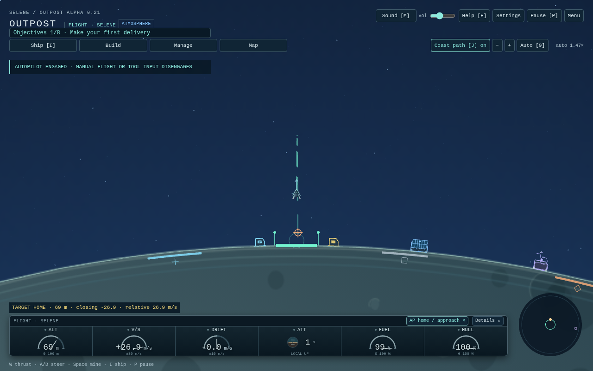
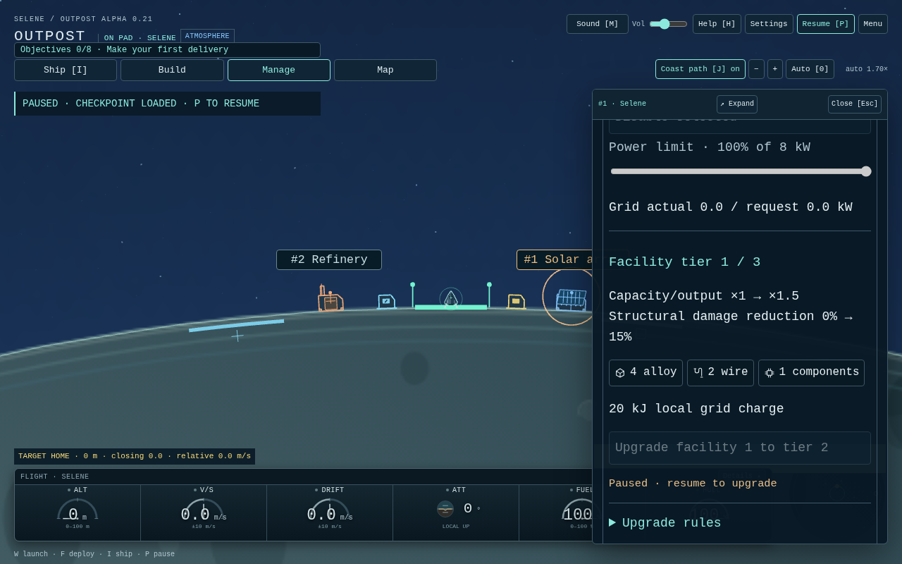

# Alpha 0.21 — Flight computers and facility administration

Task 017 follows PR #26 on a separate review branch. Neither branch is merged automatically. The catalogue now has 19 technologies, 25 parts and nine exclusive ship slots. Current checkpoint format is 19; prototype saves may reset, and no legacy migration is provided.

## Flight computers

Research and fabricate at the home shipyard using Manage → Research / Ship fitting. The three computers replace each other in the Flight computer slot; standard paid fitting, hull-scaled salvage and installed mass apply.

| Hardware | Research | Alloy / wire / components | Mass | Active ship cell draw | Programs |
| --- | --- | --- | --- | --- | --- |
| Landing computer | Flight control | 4 / 3 / 1 | 8 kg | 1 kW | Prepared local pad landing |
| Return computer | Return guidance | 8 / 5 / 2 | 15 kg | 2 kW | Landing, automatic takeoff/return-home/touchdown |
| Navigation computer | Autonomous navigation | 14 / 8 / 4 | 26 kg | 3 kW | Landing, home return, selected chart destination |

Fabrication also costs 20 kJ from the home grid. Research commits its own samples and paid powered lab work. See the connected tech map for prerequisites and exact bills.

Open Ship → Flight computer to inspect and explicitly engage a program. Successful engagement closes that window to reveal flight. The compact instrument bezel shows the captured target, active phase and an immediate AP cancel button. Reopen the flight computer for target, stage, elapsed time and cumulative computer energy. The cancel button works while paused; engaging and paid operations require running simulation.

Landing assist requires the nearest world's pad approach: within 500 m altitude and 250 m along the surface of the pad, drift ≤10 m/s, descent ≤15 m/s, tilt ≤60°, plus stopping-height/thrust checks. Below 30 m, align within 8 m of the pad, 2 m/s drift and 0.15 rad tilt first. It cannot rescue an arbitrary fast or low approach. Both worlds' pads are at longitude zero. Return home and navigation use high-clearance radial ascent and arc waypoints before transfer/approach. Full navigation captures the selected chart destination when engaged. Home/moon targets land; orbital targets match a moving offset rendezvous point. E, mining and resource transfers remain manual.

Guidance only produces ordinary turn/thrust input at 60 Hz. The same fitted mass, engine, fuel burn, shared gravity, drag, terrain and physical touchdown rules apply. No position/velocity edits, free fuel or perfect-landing overrides. Manual thrust, steering, tools, weapons, boarding or interaction disengage immediately. Towing, unavailable hardware, fuel/cell exhaustion, destroyed sites, a time limit and nearby projected collision/combat hazards also disengage visibly. A saved active program loads paused and disarmed.

Limitations: this is waypoint assistance, not a collision-proof route planner. Hazard detection hands control back; it does not avoid debris or guarantee fuel range, arbitrary loaded/weak-engine performance or a safe terrain arrival. Monitor the ship. Orbital targets can drift, deplete or become hazardous. No automatic mining, docking, combat or supply management.

## In-place facilities

Click a physical facility or enable Building labels in Settings / Manage and click its label. A compact Facility controls window exposes that actual world/id's power, operation, production and upgrade controls. Open full colony management returns to the large workspace. Inspection stays available while paused; paid controls are disabled. Existing repair/operation restrictions still apply.

| Target tier | Required research | Material bill | Local grid bill | Capacity / solar | Work and power | Incoming structural damage |
| --- | --- | --- | --- | --- | --- | --- |
| II | Infrastructure retrofits | 1× original blueprint | 20 kJ | 1.5× | 1.25× | 85% |
| III | Advanced facility systems | 2× original blueprint | 40 kJ | 2× | 1.5× | 70% |

Upgrade costs are incremental. Tier III needs more than the default 20 kJ grid buffer: build a battery and leave enough charge unreserved first. Full repair and unreserved local stock/charge are required. ID, kind, angle, footprint, inventory, enabled state, schedules, power limits, buffers and paid work remain in place. Increased storage/battery room starts empty. Refinery, fuel processor, rig and lab throughput costs proportionally more power; recipe quantities, finite seam yields and energy per unit of work stay fixed. Habitats, shields, service points and turrets retain operating output/range/buffers and gain structural protection. No upgrade repairs or refills anything. Repeated requests for the same tier never purchase the next tier; its new cost needs a fresh explicit action. Demolition refunds paid blueprint plus upgrade materials at existing hull/salvage scaling, once. Wrecked storage loses all of its capacity normally.

Labels use the actual camera projection and world/id, cull off-screen sites and stagger/omit overlapping text. Toggle state is a presentation preference, never a world mutation.

## Playtest checklist

1. Research and fabricate the landing computer. Prepare a slow pad approach; engage through native mouse or Enter/Space. Watch real fuel/cell use, AP stage and touchdown. Repeat at Nacre.
2. Buy return guidance/computer. From a different longitude or the moon, return home; interrupt with steering, thrust or AP cancel. Pause and cancel. Save active flight and reload: it must remain disarmed.
3. Buy full navigation. Select Nacre and fly there; select an orbital site and rendezvous, then interact manually. Watch hazard handoff and available fuel. Changing chart selection during a program must not silently retarget it.
4. Enable labels, select a facility, change its ordinary power/recipe controls. Upgrade to II and III using local stock. Confirm no movement, refill, repair, progress/schedule reset or duplicate charge at maximum tier. Check a moon facility separately.
5. Toggle labels off/on and reload; inspect via physical building clicks as well. Expand to full management and return. Check 900×600, 1280×800 and 1920×1080 with 150% text.

Additional production-browser previews: [Nacre facility](screenshots/facility-controls-moon.png), [900 px controls](screenshots/facility-controls-900.png), [1920 px controls](screenshots/facility-controls-1920.png), and flight computers at [900](screenshots/flight-computers-900.png), [1280](screenshots/flight-computers-1280.png) and [1920 px](screenshots/flight-computers-1920.png).

Automated validation results are recorded in the review PR; human handling, route robustness, pricing and readability still need playtest feedback.
