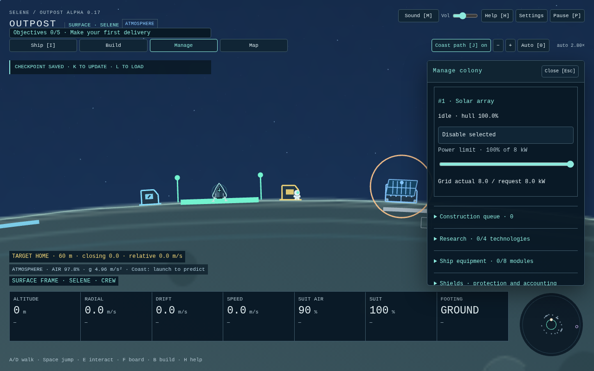

# Direct colony controls — alpha 0.17

This responds to the user's report that menus remained convoluted and routine walking felt slow after #22. It is a focused interaction follow-up, not a claim of completed human usability approval or the end of the master plan.

## Four entry points

- **Ship [I]** groups Cargo, Weapons and Defence. Threats and all critical instruments remain visible outside the panel.
- **Build** is the construction workspace: category, selected costs/footings, pointer planning, paid work queue and crew dispatch. Nearby Q/T/Enter manual placement remains available through its labeled disclosure. Local power/stocks are compact; resource priorities and survey remain available.
- **Manage** operates installed facilities, shared grid power/priorities, research/equipment, economy and existing queue controls. Click a physical facility outside placement mode to inspect it directly.
- **Map** provides live targets, system/target framing and return guidance.

Manual panel choices survive ordinary context transitions; explicit build, boarding, recovery and turret actions still provide useful context. Closing or leaving Build ends pointer placement. No menu navigation spends resources or advances a paused simulation.

## Point, click, build

Open Build or press B, choose a category and blueprint, then point near the current world's surface. The ghost uses the actual curved surface and moving body; the pointer tooltip shows cost and the real validation reason. **Left click** queues the site, committing local unreserved materials once. **Right click** finishes placement. The numeric **Build site · metres from pad** field and queue button provide the same paid action without a mouse. The last pointed site stays pinned while using panel controls.

Queue costs, research locks, whole-footprint/seam/foundation/pad checks, 16-order and 48-facility limits, cancellation/refunds and eight seconds of actual stationary crew work remain unchanged. Planning from a ship is allowed; building still requires deployed crew on the correct world. No placement in the sky, teleporting worker, remote-world supply transfer or free kit is introduced. Q/T/Enter is the existing nearby hands-on construction path, with its existing costs and crew constraints.

Paused planning can change category, selection, offset and pointer mode, but not execute placement, queue payment, refunds, crew movement or work. K stores the current view metadata with the world as before. Choosing a blueprint is not construction.

## Optional real crew orders

Outside placement, **right click ground** to walk there. **Dispatch crew to build queue** walks toward the first unpaused paid site until within an 80 m working approach, brakes normally, then the existing stationary-within-96 m rule performs the eight seconds of work. It continues to the next eligible queued site. The visible route follows the curved surface; no physics actor is skipped or teleported.

Orders use the existing 12 m/s walking speed, 30 m/s² acceleration, moving-body attachment, gravity, oxygen/habitat supply and damage. Reversing direction takes real braking time. They require healthy grounded crew on that world; an astronaut still cannot fly the ship from outside. A/D/arrows, jumping, boarding or turret control cancels automation. The HUD's **Stop crew order** also pauses the dispatched world's queue without refunds, so standing near a site cannot silently continue another order. Resume individual work orders explicitly to restart them.

Low suit air below 30 seconds without breathable coverage stops the order and pauses dispatched work. Air consumption itself continues normally: return to service, board or reach supplied coverage. Stopping is not a safety guarantee or an automatic return/refill. Loss of footing, health or the correct player/body mode ends the movement order. Blocked/paused/cancelled jobs produce explicit feedback; no unavailable work is completed invisibly.

Current **version-16** saves preserve the active order and normal queue progress. Loading stays paused with held controls cleared. Older development formats reset; no migration layer was added.

## Power and linking

The current power/material bus is shared separately within each colony. Selecting an installed facility opens its real enable, priority and power-cap controls in Manage; body-local budgets, habitats and shields remain physical. This pass does not invent decorative cable links or silently replace the grid model. A physical cable network would need a separate economy/physics/design task.

## Verification and remaining plan

Unit checks cover actual travel/acceleration/air, paid work, stopping/manual override, scarcity/locality, wrapped moon travel, current saves, fixed-clock equality and rotated pointer projection. Production browser cases use actual mouse buttons, the normal simulation, native queue/dispatch controls and public telemetry. The moon pointer case is a supplied inspection fixture; the complete normal-input moon round trip remains a separate regression.

Run typecheck, unit tests, build and all production-browser scenarios. Update screenshots and final CI evidence in the PR. Human menu usability, flight/art/audio feel and representative hardware review remain required. Wider goals/scarcity/economy balance, current-format reliability/content and release preparation follow; the master plan is not finished yet.

