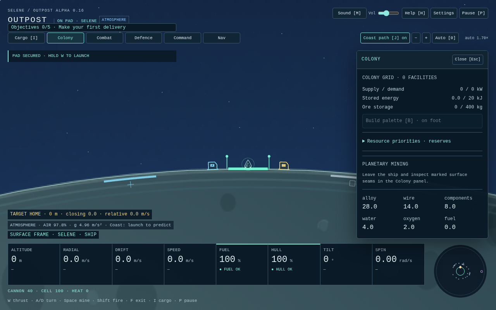

# Flight deck presentation — alpha 0.16

Task 011 implements the technical presentation and interaction pass around the existing continuous two-world game. Human handling, art, audio and full-loop usability evaluation remains open. The [audit](PRESENTATION_AUDIT.md), [direction](PRESENTATION_DIRECTION.md) and [concept](mockups/two-world-flight-logistics.svg) explain the starting point; the concept is not a screenshot or a substitute for working controls.

## Read the flight deck

The named **surface frame** above the landing instruments identifies the source used for altitude, radial/drift/total speed, tilt and spin. **Target** guidance describes relative motion to the chosen navigation destination. These frames may disagree substantially during a transfer: a ship parked on Nacre has zero surface speed while moving relative to home. The persistent region badge distinguishes atmosphere, thin air, open space and an airless surface.

Landing/fuel/hull/air warnings retain symbols, labels and sound as well as color. The 900×600 layout uses two instrument rows; larger desktops use one row. One operations panel opens at a time, leaving a clear middle flight corridor. Larger text increases panel text and retains legible capped instrument sizes in the small layout. Long panels scroll independently. Construction groups power/storage, industry/research, crew/service and defence; selected costs, footing and the actual placement failure are above the palette. Clicking a physical facility opens its Command selection, including while paused for inspection.

Nav has system fit, target focus and chart zoom. Its dashed bearing is **not a safe route**. The blocked warning means terrain occludes the target; plan around the planet. Off-chart icons clamp to the chart edge; body surfaces keep their true projected geometry. Manual camera zoom and controls-released coast prediction retain their existing physical limitations; there is no autopilot.

## Supplies and objectives

Cargo → Manufactured freight includes target manifests. Loading fills only the quantities missing aboard, atomically spending unreserved local stocks. It requires the actual landed pad link, nearby crew or pilot, and room in the shared raw/freight hold. Selecting a manifest gives nothing. Already aboard stock counts, repeated loading stops, and insufficient stock/reserves/capacity prevents the entire load. Individual ≤5 kg product transfers and raw depot loading remain available.

| Manifest | Target aboard | Use |
|---|---|---|
| Rig + solar | 15 alloy, 5 wire, 5 components (25 kg) | Rig and solar cost 12/5/3; leaves 3 alloy and 2 components. |
| Small habitat + solar | 14 alloy, 6 wire, 4 components, 4 oxygen (28 kg) | Small habitat and solar cost 14/6/3; leaves 1 component. Oxygen is finite and ongoing supply/power are still required. |

The Objectives button opens its list in the same operations dock, keeping critical flight notices unobscured. Objectives observe actual ore delivery, operating supplied industry, installed equipment, crew working at an extracting moon rig, and a subsequent flying departure/landing at home. Wreck recovery disarms the return objective. There are no rewards, teleports or granted resources. These short goals guide the sandbox; they are not a longer-term mission/event system or finished economy balance.

## Settings and native controls

Settings pauses the game and restores its previous pause state on close, as Help does. The top bar also provides Pause/Resume. Window focus loss still pauses safely. K/L remain manual checkpoint controls; no autosave or offline production was added.

- Text: standard, 125% or 150%.
- Motion: disables warning pulses, decorative flashes, animated engine/suit accents and horizon rotation. A separate option keeps the camera in its fixed world frame.
- Quality: Detailed or Reduced; fewer stars, simplified machinery/rock detail and fewer decorative bursts.
- Audio: original three-voice responsive music, independent effects/music levels and existing master volume/mute. Music changes harmony with atmosphere, airless flight, walking and threats, and ducks under urgent cues. All buses silence on pause, blur and mute. Nacre arrival has a distinct cue without an atmosphere-entry alarm.
- Bindings: each keyboard slot can use an unused supported key. Conflicts/unknown keys are rejected; resetting controls is available. Current bindings appear in Settings and contextual/bracketed hints. Long-form guide examples explicitly show defaults.

Native controls retain Enter/Space/arrow activation. Focused controls cannot thrust, walk, mine or fire. Typing in a field cannot invoke gameplay/reset/save shortcuts. Escape closes an operations panel; closing Help/Settings returns focus to gameplay and clears held keys. Preferences use `outpost.presentation.v1`, separately from the world checkpoint; unavailable/corrupt preference storage cannot block play.

Current **version-15** world saves include objective progress and the return-departure flag. Incompatible development saves reset; no legacy migration work was added.

## Art and visual budgets

Both worlds have separate deterministic cached geology, materials, craters and rim strata clipped within the physical circle. A vector rim remains aligned to terrain. Close ship art uses world metres, a readable cockpit, hull plating, gear, engine and damage cues; zoomed-out ships use an explicit navigation glyph. Crew equipment/stride, facility silhouettes, rock seams/ore diamonds and drone markings distinguish the actors. All art and audio remain original and procedural.

| Work | Bound / policy |
|---|---|
| Physics / colonies | Existing fixed 60 Hz; all distant actors, threats and colonies still simulate. |
| HUD | At most 10 updates/s; navigation/Command detail generation runs only when viewed. Core telemetry and cargo/colony data stay current across panel changes and reset/load. Stable native elements/focus are patched rather than replaced. |
| Stars / body textures | 240 / 80 stars, redrawn only after resize/quality change; one cached surface texture per world and one atmosphere texture. |
| Decorative bursts | At most 12 fracture/impact bursts + 12 combat flashes (Detailed); 4 + 4 (Reduced); zero with reduced motion. Each fracture burst has six marks and a ring for ≤0.4 s. |
| Audio | Three music voices, four machinery/tool/engine loops and at most 20 scheduled effect voices. |
| Culling | Off-screen rocks, pickups, facilities, drones and projectiles skip drawing; actual simulation is unaffected. |
| Pause | Stable camera/selection/settings/world state reuses the vector scene; warnings and decorative motion stop. UI inspection still works. |

The HUD exposes rolling 120-sample CPU submission means/p95 for scene drawing and a mean for HUD generation, plus quality caps. These are development measurements, **not GPU frame times or an FPS guarantee**. The stress browser case loads 256 rocks, 256 ore pickups, 48 home facilities and 24 moon facilities; it checks bounded DOM work, stable paused draw count, and advancing moon mining after resume. This seeded performance fixture is distinct from the normal-control playthroughs. The indicative goal is under 8 ms scene-submission p95 and under 8 ms mean HUD generation on the test host; representative lower-powered hardware remains a human/release check.

A short final cloud-Chromium stress sample measured **0.80 ms mean / 1.90 ms p95** scene submission and **3.77 ms mean** HUD work over 25 live draw samples. Initial paused-scene submission averaged 3.75 ms including warm-up, then the vector rebuild count stayed fixed. These are short software-rendered shared-host observations, not representative GPU/hardware validation. The shared simulation benchmark under browser load averaged 0.24 / 0.43 / 0.61 ms for parent / fragment / ore workloads, with noisy contention outliers.

## Verification and review

Run `npm run typecheck`, `npm test`, `npm run build`, `npm run benchmark`, and `PLAYWRIGHT_BROWSERS_PATH=/tmp/outpost-browsers npm run test:preview` (or install Playwright Chromium normally). The suite includes manifest conservation/locality, persistence, binding validation, camera preferences, bounded render effects, native focus/rebinding, audio bus output and supported desktop sizes, alongside all existing gameplay routes. Fresh actual captures are generated by these tests; the enlarged-text hazard and physical-facility selection captures are explicit seeded inspection fixtures.

Full-suite and final CI results will be recorded in the implementation PR. Human review should cover a complete first-time loop, large text at the smallest desktop, manual moon navigation/return, warnings/music intelligibility and representative low-powered performance. Do not mark that review complete from automated checks or screenshots.

Current captures: [900](screenshots/presentation-900.png), [1280](screenshots/presentation-1280.png), [1920](screenshots/presentation-1920.png); enlarged paused hazard fixtures at [900](screenshots/overhaul-900.png), [1280](screenshots/overhaul-1280.png), [1920](screenshots/overhaul-1920.png); [physical facility inspection fixture](screenshots/overhaul-facilities.png); [Nacre surface instruments and local controls](screenshots/moon-shield-controls.png).
