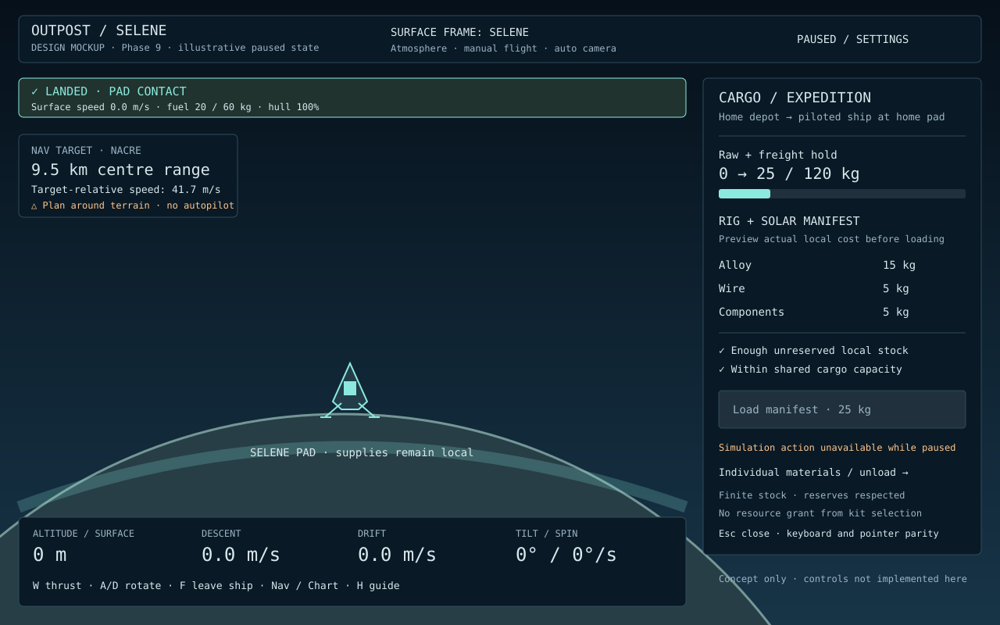

# Initial graphics, UX and UI audit — alpha 0.4

This is a technical audit of the playable combat slice and captured production-browser screenshots, not a completed human usability study. It starts the user's requested Phase 9 overhaul before automation adds further interface complexity. The full redesign remains required before Phase 10 reliability/release playtesting.

| Area | Current finding | Overhaul direction |
|---|---|---|
| HUD hierarchy | Flight, mining, colony and defence information compete for space; important actions can sit below the colony panel's scroll fold. | Contextual flight, crew, construction and turret layouts; a compact persistent safety/weapon layer. |
| Combat visibility | Upper HUD bands can cover approaching targets. The new patrol notice was shortened as an immediate mitigation. | Reserve a clear play area, improve camera framing/look-ahead, and test threats around every panel edge. |
| Camera | Auto zoom follows altitude; manual zoom helps interception, but discovering the right scale is still manual. | Comfortable mode framing, clearer auto/manual state, scale references and reduced-motion options. |
| Graphics | Vector silhouettes, cached planet haze and placeholder structures convey function but lack a complete visual identity. | Cohesive retro palette, typography, icons, terrain/atmosphere detail, recognizable facility silhouettes, animation and restrained effects. |
| Target feedback | HP bars, windup lines, flashes, radar and named drone states provide a baseline; color remains a heavy signal. | Non-color target/weapon identifiers, readable hit confirmation and threat priority at multiple zoom scales. |
| Interaction flow | Keyboard shortcuts are numerous. Mouse controls need reliable return to game input; supplies/services can produce several separate notices. | Consistent contextual prompts, discoverable controls/rebinding, grouped service receipts and explicit reasons for unavailable actions. |
| Construction/economy | A long scrolling panel combines blueprint choice, placement, nearby operations and global inventories. | Separate selection/placement/operations surfaces with clearer costs, power/ammo priorities and failure feedback. |
| Accessibility/layout | Desktop prototype layouts and native keyboard controls exist; full text scaling, contrast, reduced motion and quality settings do not. | Validate 900×600, 1280×800 and 1920×1080, keyboard focus, scalable text, non-color cues and effect budgets on lower-powered hardware. |

Before Phase 7 interface expansion, draft visual direction and contextual layout mockups around these findings. During the full Phase 9 overhaul, run human launch→mine→land→build→defend/combat→repair→save playtests, record task completion/confusion and resolve blocking findings. Establish measured frame-time/quality budgets and visual/input regressions. Do not mark the overhaul complete from screenshots or automated tests alone.

## Alpha 0.5 follow-up

The [presentation foundation](PRESENTATION_DIRECTION.md) now supplies visual-direction tokens, flight/construction/combat wireframes and live desktop references. The playable UI uses one contextual dock, bottom telemetry, a reserved central corridor, grouped notice flow and native keyboard/mouse navigation with help/pause checks. Planet shading/strata remain cached procedural graphics. These address the first hierarchy/occlusion/interaction findings; they do not complete human usability testing, final art, adaptive camera behavior or accessibility/performance options. Use this foundation for Phase 7 interfaces, then complete the broader Phase 9 checklist.

## Alpha 0.15 technical follow-up — two-world loop

The complete supplied moon trip is automated and current screenshots were technically inspected. This is not a human usability study. Use the existing retro palette/one-dock foundation, but the full Phase 9 overhaul remains required.

| Area | Observed in the implemented game | Next overhaul acceptance |
|---|---|---|
| Frame hierarchy | Corrected moon instruments now show surface-relative zero at rest; navigation can simultaneously target home with a large relative speed. The header names Nacre but the two velocity references need deliberate hierarchy. | Explicit surface-frame and target-frame labels, legible velocity/approach cues and no ambiguous atmosphere announcements. |
| Text/layout | Supported desktop bounds pass, but secondary labels remain around 9–10 px and long Command/freight sections scroll substantially at 900×600. | Larger/scalable text, consistent spacing and readable persistent safety instruments without blocking the flight corridor. |
| Logistics | Actual finite freight now works, but a solar/rig expedition involves repeated 5 kg product transfers and a long list of product/raw rows. | Clear capacity/mass/ownership and an efficient paid manifest workflow; selecting a kit never grants it. |
| Construction | Fifteen blueprints, costs, research locks and invalid-site feedback exist in one long palette. Body-local seams/footings/coverage are real. | Group selection/placement/operations, improve snap/footprint/coverage feedback and clarify unavailable actions. |
| Navigation | The live chart/radar fits both worlds; bodies, belts and sites share a small overview. Return flight may require routing around home. | Readable source/destination landmarks, usable chart scale, terrain-occlusion/return guidance and manual route planning. |
| Graphics | Cached planet art, tinted moon, vector ship/crew/structures and restrained effects work, but still look like prototype placeholders. | Cohesive distinctive silhouettes/materials/lighting/animation. Align close-range hull/gear and terrain with physical envelopes; use explicit distant icons. |
| Onboarding | H documents the controls, supplied moon route and limitations. The sandbox does not yet guide a new player through the whole economy/flight progression. | Practical short objectives/context prompts driven by actual simulation results, without taking over flight or granting free supplies. |
| Audio/accessibility | Original cues, global mute/volume, reduced CSS pulses and optional shield accents exist. Full mix/music, text scaling, rebinding and camera/effect preferences remain absent. | Complete settings/accessibility, distinct useful cues and independent audio controls without false alarms or pause/load noise. |
| Performance | Two-source physics benchmarks have ample mean-step headroom, while full renderer/DOM/effect budgets still need representative hardware measurements. | Bound/cull visual work, cache static/paused rendering where useful and offer quality levels without freezing distant physics/colonies. |

Keep the actual two-world transfer/work/return, supplied research/equipment, shields/habitats, keyboard focus, pause, save continuation and supported desktop layouts in the regression suite. Human handling/usability/art/audio evaluation remains explicit review work.

### Next-phase concept

This is a design mockup, not a runtime screenshot or implemented manifest control. It proposes a distinct surface frame versus target frame, persistent safety instruments, and an explicit finite rig/solar freight preview. The pause example disables loading; live execution must obey local stock/reserves, shared hold capacity, actual mass and physical pad access. Validate larger text and compact layouts before adopting the composition.
