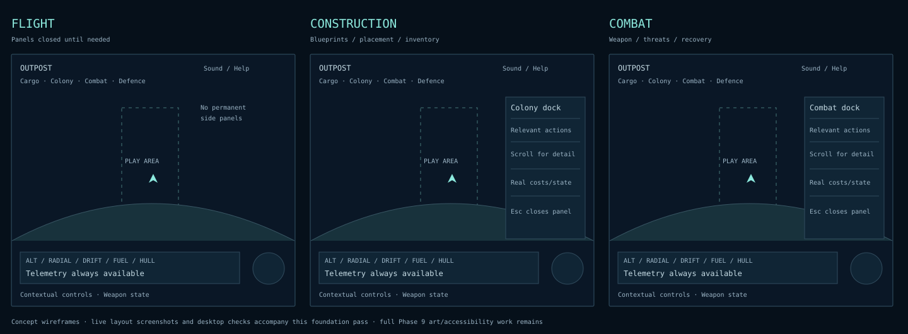

# Presentation foundations — alpha 0.5

This implements the early visual-direction and contextual-layout work scheduled after Phase 6, before Phase 7 adds automation controls. It follows the [initial audit](PRESENTATION_AUDIT.md). It is a playable foundation pass; it does not complete the later graphics/UX/UI overhaul or replace human usability testing.

## Direction and hierarchy

Retain the retro instrument-panel identity, with a restrained dark navy world, mint interaction/telemetry highlights, warm danger accents and a consistent monospaced type hierarchy. Keep information near screen edges and one detail panel open at a time. Planet shadow/strata remain cached procedural art inside the real circular collision surface.

| Token | Value / use |
|---|---|
| Background | `#06101a` |
| Panel | `#091925f5`; opaque enough to read against atmosphere |
| Border | `#304b5d`; one-pixel structure |
| Primary text / secondary | `#d9e8ed` / `#9bb4c5` |
| Interaction / warning | `#8ce9dd` / `#ffc58c`; accompany color with text/state |
| Typography | System monospace; 20–23 px telemetry, 11 px panel actions, 9–10 px secondary labels |
| Spacing | 24 px screen inset, 6–16 px internal gaps; one scrolling operations dock |

The wireframes above cover flight, construction and combat. These [900×600](screenshots/presentation-900.png), [1280×800](screenshots/presentation-1280.png) and [1920×1080](screenshots/presentation-1920.png) captures are live runtime references, including a manually opened Colony panel. The playtest captures also show the actual contextual flight, construction, defence and combat states.

## Interaction contract

Cargo, Colony, Combat and Defence buttons select a single right-hand operations dock. **I** toggles Cargo; **Esc** closes the dock. Ordinary flight starts with details closed. Construction, depot use, turret control, incoming meteors and hostile combat choose a relevant panel when their context begins. User selection/closure stays in effect until the next context transition. A panel does not reopen every telemetry update. Panel selection is UI state, outside world checkpoints.

Flight telemetry, atmosphere/coast information, weapon state, warning notices and radar remain visible when the dock is closed. The former wall of shortcuts becomes a short context hint. Long notices flow vertically in a bounded left area. Radar occupies its own lower-right space, outside the instrument strip.

Clicking a game action returns pointer focus to gameplay; keyboard buttons keep native navigation and activation. Enter/Space/arrows used within controls do not also trigger gameplay. Esc returns focus to gameplay when closing a panel. In help, Esc closes the dialog and preserves the underlying panel/pause state. Panel browsing and zoom work while paused; simulation actions stay disabled. Closing a panel never pauses or resumes the world.

## Validation and remaining work

Production browser checks measure control bounds, panel separation and an unobstructed central corridor (40–60% of viewport width, 27–59% of height) at the three supported desktop sizes. They also exercise paused keyboard/mouse browsing, help/Escape behavior, context transitions, nine-blueprint scrolling and the existing gameplay routes. This is a check of DOM presentation bounds, not a guarantee that every possible world target is visible behind every screen-edge panel. Esc is available to clear details.

Full ship/astronaut/structure artwork, adaptive combat camera framing, scalable text, rebinding, reduced motion/effects, graphics quality settings, music/mix polish, lower-powered hardware budgets and human usability studies remain in Phase 9. Mobile/touch support remains later work. The simulation, collision surface, save format and physical tuning are unchanged in this pass.

## Alpha 0.16 technical overhaul

[Task 011](archive/tasks/CODEX_TASK_011.md) and the [current presentation model](PRESENTATION.md) supersede the small-text foundation layout with scalable operations text, an explicit surface/target hierarchy, two instrument rows at small desktop widths, paid manifests, grouped blueprints, objectives and unified settings/rebinding/audio controls. Body-specific procedural art and bounded/cached/cullable rendering replace the earlier single tinted body and generic machinery. The technical overhaul is in verification/review; human usability/art/audio review and representative hardware validation remain open.
